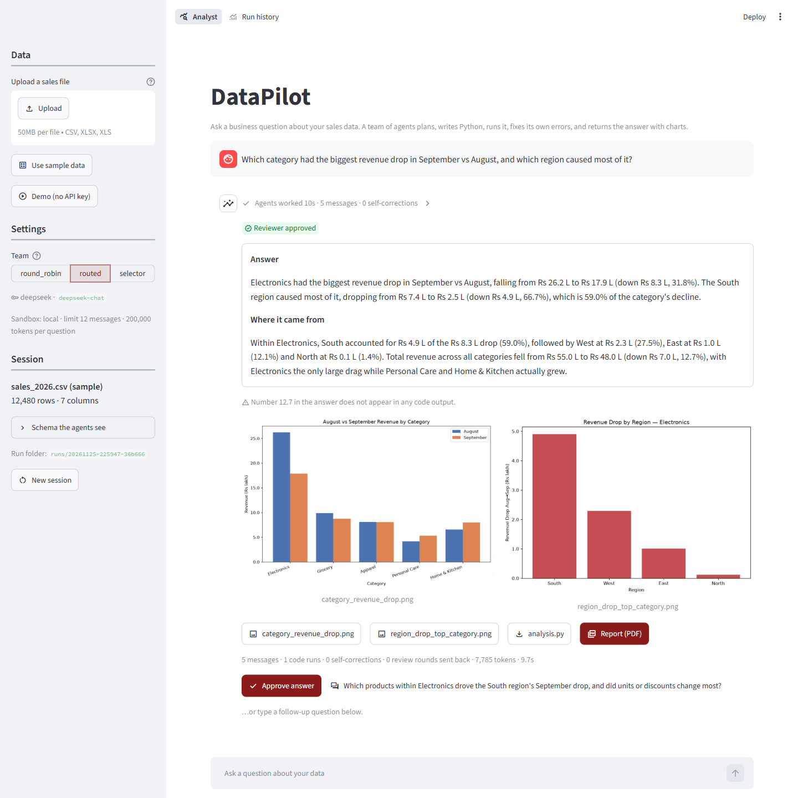
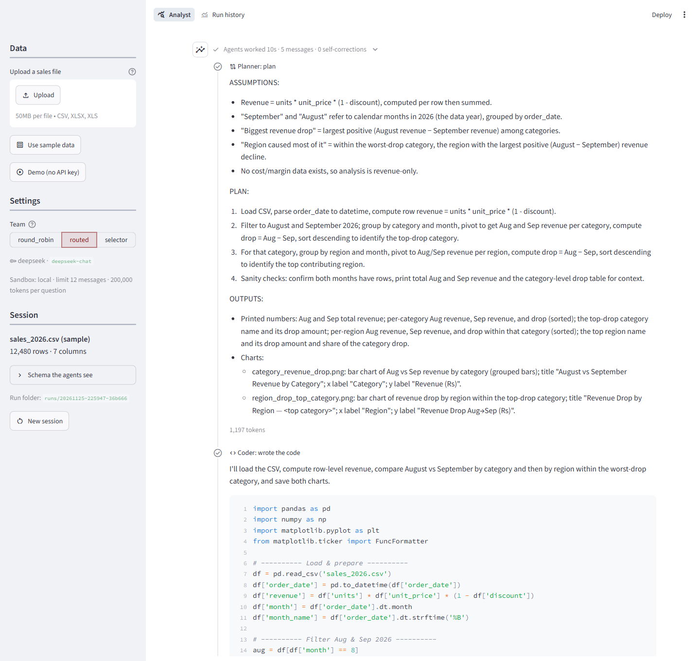
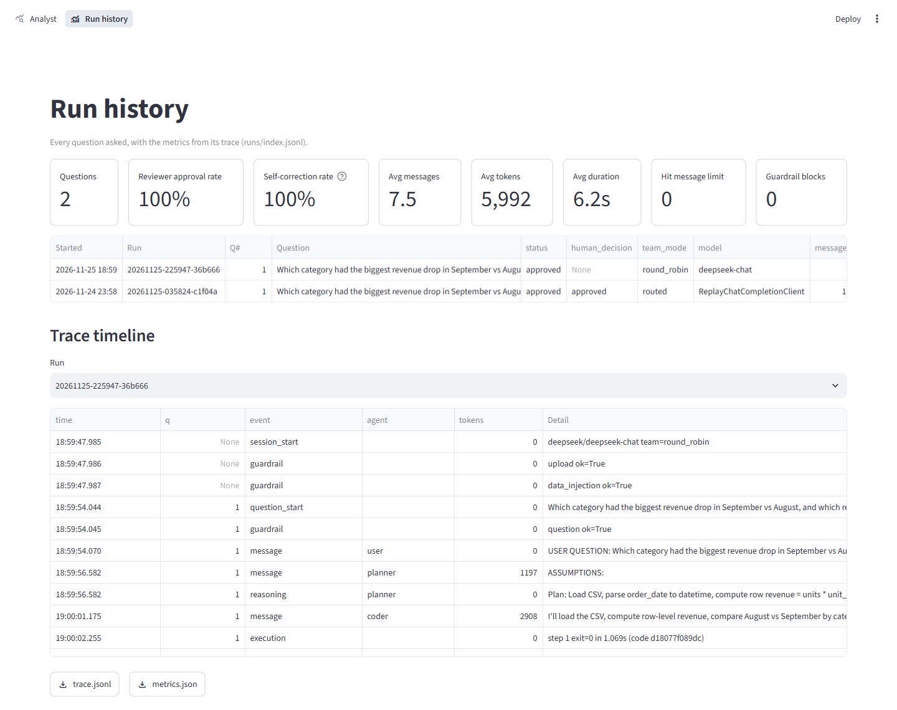

# DataPilot — Self-Correcting AI Data Analyst

**Ask a business question in plain English. Get an answer whose every number was calculated by code, checked by a reviewer, and can be re-run.**


DataPilot is a multi-agent system built on **Microsoft AutoGen**. **Four AI agents and one human** work in a single conversation:

1. The Planner breaks the question into steps.
2. The Coder writes pandas + matplotlib code.
3. The Executor runs it in a sandbox.
4. The Coder fixes its own errors, until the Reviewer approves the result.
5. You approve the answer or ask a follow-up.

What you get back:

- **A plain-English answer**
- **Labelled charts (PNG)**
- **A working `analysis.py`** that reproduces every figure
- **A one-page PDF report**

<p align="center">
  
</p>
<p align="center"><em>One question, about 10 seconds, 5 agent messages: a reviewer-approved answer, labelled charts, the re-runnable <code>analysis.py</code> and a PDF report. The warning under the answer is the grounding guardrail flagging a percentage the reviewer worked out itself instead of quoting the code's output.</em></p>

---

## Table of contents

- [The problem](#the-problem)
- [How DataPilot solves it](#how-datapilot-solves-it)
- [Key features](#key-features)
- [Agent orchestration](#agent-orchestration)
- [How tool calls work](#how-tool-calls-work)
- [Why AutoGen](#why-autogen)
- [Guardrails](#guardrails)
- [Observability](#observability)
- [Evaluation results](#evaluation-results)
- [Quick start](#quick-start)
- [Configuration](#configuration)
- [Project structure](#project-structure)
- [Testing](#testing)
- [Roadmap](#roadmap)

---

## The problem

Business owners, sales managers and operations heads have their data in CSV and Excel files. Their questions are simple:

> *"Which category had the biggest revenue drop in September vs August, and which region caused most of it?"*

Getting the answer is not simple:

| Today's options | Why they fall short |
|---|---|
| Ask a data analyst | Slow. Every question waits in a queue, and a follow-up means another wait. |
| Build it in Excel / BI tools yourself | Needs skills most business users don't have. Easy to get pivot tables and filters wrong. |
| Paste data into a chatbot | **The model guesses numbers.** It can't verify them, the figures sound right but are often wrong, and nobody can check how they were produced. |

Wrong numbers lead to wrong decisions. The real need is an analyst that is **fast and conversational, but only reports figures it actually calculated**.

## How DataPilot solves it

| Requirement | DataPilot's approach |
|---|---|
| **Correct numbers** | The LLM never produces figures itself. Every number comes from executed pandas code. A grounding guardrail rejects any answer quoting a number that does not appear in the code output. |
| **Handles mistakes like a human analyst** | When code fails, the error goes back to the Coder, who rewrites the script. The loop continues until the code runs and the Reviewer is satisfied. |
| **Answers you can trust** | A separate Reviewer agent checks completeness, sanity and chart labelling before anything reaches you. |
| **Auditable** | Every answer ships with `analysis.py`. Running it again gives the same numbers. A full trace records every message, script and decision. |
| **Non-programmer friendly** | Plain-English chat in Streamlit. You can watch the agents work live and approve or ask a follow-up with one click. |
| **Safe** | Generated code is screened by an AST (syntax-tree) policy and runs in an isolated sandbox. API keys never reach that code. Optional Docker isolation has no network access. |
| **Fast and bounded cost** | A typical question takes **~5 messages, ~6–7k tokens and ~8 seconds**. Hard caps of 12 messages and a token budget apply to each question. |

**Example output** (live run, DeepSeek):

```
ANSWER
Electronics had the biggest revenue drop in September vs August, falling from Rs 26.2 L to
Rs 17.9 L (down Rs 8.3 L, 31.8%). The South region caused most of it, dropping from Rs 7.4 L
to Rs 2.5 L (down Rs 4.9 L, 66.7%), which is 59.0% of the category's decline.

WHERE IT CAME FROM
Electronics' Rs 8.3 L drop was the largest of the five categories (next was Grocery at Rs 1.1 L)...

FILES
category_revenue_drop.png | region_drop_worst_category.png | analysis.py

SUGGESTED NEXT QUESTION
Which products within Electronics drove the South region's September drop?
```

---

## Key features

- 🤖 **Multi-agent team**: Planner, Coder, Executor and Reviewer collaborate in one conversation, with a human approval step at the end.
- 🔁 **Self-correction**: execution errors, blocked code and unlabelled charts are fed back to the Coder automatically.
- 🧮 **Grounded answers**: every number in the final answer is traced to code output. The checker understands lakh, crore, % and rounding. If the check fails, the team gets one automatic retry.
- 🛡️ **8 layers of guardrails**: upload, question, data, code, runtime, charts, answer and cost.
- 📦 **Sandboxed execution**: a separate folder for each run with a timeout and API keys removed from the environment. Optional Docker sandbox with no network, non-root user and CPU/memory/process limits.
- 💬 **Live agent conversation** streamed in the Streamlit UI, including errors and fixes.
- 🙋 **Human in the loop**: approve the answer, or ask a follow-up that continues the same session and context.
- 🔀 **Three orchestration modes**: fixed round-robin, rule-based routing, or LLM-selected next speaker.
- 📊 **Excel with multiple sheets** as well as CSV.
- 📄 **One-page PDF report** with the answer and charts.
- 🔍 **Full observability**: per-run traces, metrics and a cross-session index, plus a **Run history** dashboard.
- ✅ **Evaluation harness**: a golden question set with answers computed by pandas, and scoring by fixed rules instead of another LLM.
- 🔌 **Provider-agnostic**: Groq or DeepSeek through OpenAI-compatible APIs. You can use a different model for each agent role.
- 🧪 **Demo mode**: try the full flow without an API key. Agent replies are scripted, but the code really runs.

---

## Agent orchestration

DataPilot orchestrates **5 agents: 4 autonomous AI agents + 1 human proxy**.

| # | Agent | AutoGen class | Responsibility |
|---|---|---|---|
| 1 | **Planner** | `AssistantAgent` | Reads the question and data schema. States assumptions and a 3–6 step plan with the expected outputs and charts. Never writes numbers. |
| 2 | **Coder** | `AssistantAgent` | Writes one complete, self-contained pandas/matplotlib script per turn. Rewrites the whole script after an error or feedback. |
| 3 | **Executor** | `CodeExecutorAgent` + custom `SandboxExecutor` | Runs only the Coder's Python, inside the sandbox. Returns `STATUS: SUCCESS` with the output, or `STATUS: ERROR` with a short traceback. |
| 4 | **Reviewer** | `AssistantAgent` | Checks that the run succeeded, the question is fully answered, the numbers make sense and the charts are labelled. Replies `REVISE: …` or `APPROVED` with the final answer. |
| 5 | **User** | `UserProxyAgent` | The human. Approves the final answer or asks a follow-up in the same session. |

### Workflow

```
 Upload CSV / Excel  +  question
        │
        │  Input guardrails: file type/size · prompt-injection screen · data-text scan
        ▼
 ┌──────────────────────── AutoGen group chat ────────────────────────┐
 │                                                                    │
 │   Planner ──► Coder ──► Executor (sandbox) ──► Reviewer            │
 │                 ▲            │                     │               │
 │                 │   error / blocked code /         │ REVISE        │
 │                 │   chart check failed             │               │
 │                 └────────────┴─────────────────────┘               │
 │                                                                    │
 │  Stop when: "APPROVED" (only from the Reviewer)                    │
 │           | 12 messages | token budget                             │
 └────────────────────────────────────────────────────────────────────┘
        │
        ▼
 Grounding guardrail: every number must appear in code output (1 auto-retry)
        │
        ▼
 Human (UserProxyAgent): approve ✔  or  ask a follow-up ↻ (same team, same context)
        │
        ▼
 Answer · charts (PNG) · analysis.py · PDF report · trace + metrics
```

### Watch the agents work

Each agent's turn is streamed live and can be expanded: the Planner's assumptions and plan, the Coder's script, the Executor's output and the Reviewer's verdict.

<p align="center">
  
</p>

### Orchestration modes

Choose a mode with `DATAPILOT_TEAM` or in the sidebar:

| Mode | AutoGen team | How the next speaker is chosen | Best for |
|---|---|---|---|
| `round_robin` | `RoundRobinGroupChat` | Fixed order: Planner → Coder → Executor → Reviewer | A simple, predictable baseline |
| `routed` | `SelectorGroupChat` + rule-based `selector_func` | Rules: errors go straight back to the Coder; `REVISE` goes to the Planner or Coder | **Lowest cost and fewest messages (recommended)** |
| `selector` | `SelectorGroupChat` (the LLM picks) | The LLM chooses the next speaker. Errors are still always sent to the Coder. | Flexible, open-ended workflows |

The stop rule combines three of AutoGen's conditions:

```python
TextMentionTermination("APPROVED", sources=["reviewer"])   # only the Reviewer can end the run
| MaxMessageTermination(12)                                 # hard cap on conversation length
| TokenUsageTermination(max_total_token=200_000)            # cost guardrail
```

---

## How tool calls work

DataPilot deliberately uses **code execution as its only tool**, instead of LLM function-calling with JSON arguments. The model writes a complete program, and only that program's output counts as evidence.

```
Coder message                CodeExecutorAgent                       SandboxExecutor
─────────────               ──────────────────                      ───────────────
"Fixed the date parse.  ─►  1. extract the ```python block   ─►   3. write step_NN.py into runs/<id>/
 ```python                  2. approval_func = code_approval       4. run with timeout, cwd = sandbox,
 import pandas as pd ...       └─ guardrails.check_code()             no API keys in the environment
 ```"                             AST policy: allowed imports,     5. savefig hook records chart metadata
                                  no os/subprocess/network/        6. on success → save as analysis.py
                                  eval/exec/delete/abs paths
                                                                    ◄─ "STATUS: SUCCESS\n<stdout>"
                                                                       or "STATUS: ERROR\n<traceback>"
```

- **Approval gate:** `CodeExecutorAgent(approval_func=code_approval)`. Every code block is checked against the policy before it can run. Blocked code goes back to the Coder as an error, with the reason.
- **Custom executor:** `SandboxExecutor` implements AutoGen's `CodeExecutor` interface, so it plugs in directly. `DockerSandboxExecutor` is a drop-in alternative.
- **Model calls:** the Planner, Coder and Reviewer (and the speaker-picker in `selector` mode) call the LLM through `OpenAIChatCompletionClient` at `temperature=0`. One client per role lets you mix models, for example a stronger model for the Coder.
- **Streaming:** `team.run_stream()` yields each message and event as it happens. The Streamlit UI and the trace logger both consume this stream.

---

## Why AutoGen

The core of this problem is a **loop where the next step is decided at run time**. An error sends work back to the Coder, and reviewer feedback sends it back again. That conversation-driven loop is exactly what AutoGen is built for.

| What DataPilot needs | AutoGen | Task-pipeline frameworks (e.g. CrewAI) |
|---|---|---|
| Next step decided at run time (errors → Coder, feedback → Planner or Coder) | Agents share one conversation and loop until a stop rule fires. This is the core model. | Built around ordered tasks or a manager agent. Going back to an earlier step needs extra wiring. |
| Run code → see the error → fix it, between agents | `CodeExecutorAgent` runs code found in messages and posts the result into the chat. A custom sandbox plugs in. | Code execution is a tool inside one agent. Self-correction stays inside that agent. |
| Stop on `APPROVED` **or** a message cap | Built-in conditions that combine with `\|` | Has to be built from iteration limits and output checks |
| Live view of the conversation | `run_stream()` yields every message | Callbacks and event hooks, organised around tasks |
| Human approval + follow-up in the same session | `UserProxyAgent`; team state carries over between questions | Human input per task; continuing a session needs custom state |
| Choose the next speaker by rules or by the LLM | `SelectorGroupChat` with `selector_func` | Manager or hierarchical process |

Task-pipeline frameworks shine when the work is a fixed sequence of roles (research → write → edit). DataPilot's path is not fixed, so a conversational multi-agent framework is the better fit.

### Tech stack

| Layer | Technology |
|---|---|
| Agent framework | `autogen-agentchat` 0.7, `autogen-ext[openai]` |
| LLM providers | DeepSeek (`deepseek-chat`, `deepseek-reasoner`), Groq (`openai/gpt-oss-120b`), both through OpenAI-compatible APIs |
| Data and charts | pandas, NumPy, matplotlib, openpyxl |
| UI | Streamlit (multi-page: Analyst and Run history) |
| Reporting | ReportLab (PDF) |
| Isolation | Local sandbox folder, or Docker (`docker` SDK) |
| Testing | pytest, pytest-asyncio, AutoGen `ReplayChatCompletionClient`, Streamlit `AppTest` |

---

## Guardrails

| Layer | Protection | Implementation |
|---|---|---|
| **Upload** | CSV/XLS/XLSX only, size limit, must be readable, row and sheet limits | `guardrails.check_upload`, `dataset.describe` |
| **Question** | Length limits. Blocks attempts to override instructions, seek secrets or force "APPROVED". | `guardrails.check_question` |
| **Data** | Flags instruction-like text hidden in headers or cells. The schema is passed to the agents marked as untrusted data. | `guardrails.scan_data_for_injection` |
| **Code** | Checks the code's syntax tree before execution: import allowlist; no `os`, `subprocess`, network, `eval`/`exec`, deleting files, absolute or `..` paths, pickle/SQL/HTML readers | `guardrails.check_code` + `approval_func` |
| **Runtime** | Separate folder per run, timeout, API keys removed, fixed hash seed, tracebacks without host paths. Docker: no network, memory/CPU/process limits, non-root user. | `sandbox.py`, `docker_sandbox.py` |
| **Charts** | Every chart needs a title, axis labels and units, or the Coder gets feedback | `sandbox_hooks/sitecustomize.py`, `guardrails.check_chart_meta` |
| **Answer** | Every number must be traceable to executed output; understands lakh, crore, % and rounding | `guardrails.check_answer_grounding` |
| **Cost** | 12-message cap, token budget per question, retry limits | `team.build_termination` |

---

## Observability

Every question leaves a complete record:

| Artifact | Contents |
|---|---|
| `runs/<run_id>/trace.jsonl` | Every message (with tokens and latency), plans, review verdicts, model reasoning, code executions (code, output, exit code, duration), guardrail decisions, outcome and human decision |
| `runs/<run_id>/metrics.json` | Per question: messages, executions, errors, self-corrections, review rounds, tokens and time per agent, status, grounding |
| `runs/index.jsonl` | One line per question across all sessions |
| `runs/<run_id>/step_NN.py`, `analysis.py`, `*.png` | Every script attempted, the final working script and the charts |

```bash
python -m datapilot.report                  # KPIs + recent runs
python -m datapilot.report --run <run_id>   # timeline of one run
```

The Streamlit **Run history** page shows the same KPIs, every question asked, and a trace timeline for each run.

<p align="center">
  
</p>

---

## Evaluation results

There are ten golden cases, with expected values computed directly by pandas:

- The brief's main question (biggest category drop and which region caused it)
- Totals, rankings, a best month, percentage share, filters and averages
- An **unanswerable** question (the data has no cost column)
- A **prompt injection** attempt
- A **destructive** request

Scoring uses fixed rules, not an LLM judge. Each case is checked for:

- Correct entities, and correct numbers (lakh, crore and % aware)
- Reviewer approval, and staying within the message limit
- Self-correction, and grounding of every number
- Chart labels
- **Reproducibility:** `analysis.py` is re-run in a fresh sandbox

**Live results** (DeepSeek `deepseek-chat`, 10 cases per mode):

| Metric | `round_robin` | `routed` | `selector` |
|---|---|---|---|
| Cases passed | **10/10** | **10/10** | **10/10** |
| Correct numbers | 100% | 100% | 100% |
| Grounded answers | 100% | 100% | 89% |
| Charts labelled | 100% | 100% | 100% |
| `analysis.py` reproduces the numbers | 100% | 100% | 100% |
| Within message limit | 100% | 100% | 100% |
| Avg messages / question | 5.4 | 5.3 | 5.7 |
| Avg tokens / question | ~6.8k | ~6.4k | ~7.4k |
| Avg time / question | 8.0 s | 8.2 s | 10.7 s |

In all three modes the prompt injection was rejected by the input guardrail, and the destructive request was handled safely.

The one `selector` grounding miss: the Reviewer worked out an extra percentage itself instead of quoting one printed by the code. The figure was correct, but it was not grounded.

```bash
python -m evals.run --offline                       # check the harness with scripted agents (free)
python -m evals.run --cases spec_drop               # one live question, default modes
python -m evals.run --modes round_robin routed selector
python -m evals.run --repeat 3 --sleep 10           # repeated runs, gentle on rate limits
```

Each run writes `eval_results/<timestamp>/report.md`, which compares the team modes.

---

## Quick start

**Prerequisites:** Python 3.11+, plus an API key for [DeepSeek](https://platform.deepseek.com) or [Groq](https://console.groq.com). Docker is optional.

```bash
git clone https://github.com/strangefirm/DataPilot.git && cd DataPilot
python -m venv .venv && source .venv/bin/activate      # Windows: .venv\Scripts\activate
pip install -r requirements.txt

cp .env.example .env            # set DATAPILOT_PROVIDER and the matching API key
python scripts/generate_sample_data.py    # creates data/sales_2026.csv + data/ground_truth.json
python scripts/check_llm.py               # should print PONG

streamlit run streamlit_app.py
```

Then in the app:

1. Click **Use sample data**, or upload your own CSV or Excel file.
2. Ask a question.
3. Watch the agents work.
4. Approve the answer or ask a follow-up.
5. Download the charts, `analysis.py` or the PDF report.

> **No API key?** Click **Demo (no API key)** in the sidebar. It replays a scripted agent conversation on the sample data, and the code really runs.

**Command line:**

```bash
python -m datapilot.cli --data data/sales_2026.csv \
  --question "Which category had the biggest revenue drop in September vs August, and which region caused most of it?"
```

**Docker sandbox (optional):**

```bash
docker build -t datapilot-sandbox docker/
# then set DATAPILOT_EXECUTOR=docker in .env
```

---

## Configuration

All settings are read from `.env`:

| Variable | Default | Description |
|---|---|---|
| `DATAPILOT_PROVIDER` | `groq` | `groq` or `deepseek` |
| `GROQ_API_KEY` / `GROQ_MODEL` | — / `openai/gpt-oss-120b` | Groq credentials and model |
| `DEEPSEEK_API_KEY` / `DEEPSEEK_MODEL` | — / `deepseek-chat` | DeepSeek credentials and model (`deepseek-reasoner` exposes its reasoning) |
| `DATAPILOT_TEAM` | `round_robin` | `round_robin`, `routed` or `selector` |
| `DATAPILOT_EXECUTOR` | `local` | `local` or `docker` |
| `DATAPILOT_EXEC_TIMEOUT` | `60` | Seconds allowed per code execution |
| `DATAPILOT_MAX_MESSAGES` | `12` | Message cap per question |
| `DATAPILOT_MAX_TOKENS_PER_RUN` | `200000` | Token cap per question |
| `DATAPILOT_MAX_UPLOAD_MB` | `50` | Upload size limit |
| `DATAPILOT_RUNS_DIR` | `runs/` | Where sessions, traces and metrics are stored |

---

## Project structure

```
datapilot/
├── config.py              # settings loaded from .env
├── llm.py                 # Groq / DeepSeek client factory (OpenAI-compatible)
├── prompts.py             # system messages for Planner, Coder, Reviewer
├── team.py                # agents, team modes, routing, termination
├── session.py             # one dataset, many questions; grounding retry; human review
├── sandbox.py             # SandboxExecutor (AutoGen CodeExecutor) + Workspace
├── docker_sandbox.py      # Docker-isolated executor
├── sandbox_hooks/         # savefig hook that records chart metadata
├── guardrails.py          # all eight guardrail layers
├── dataset.py             # schema description for CSV and multi-sheet Excel
├── observability.py       # traces, metrics, cross-session index
├── report.py              # terminal KPIs and run timelines
├── pdf_report.py          # one-page PDF export
├── demo.py                # scripted demo mode (no API key)
├── ui.py, app_state.py    # Streamlit helpers and per-user state
├── async_bridge.py        # persistent event loop for async agents under Streamlit
└── cli.py                 # command-line interface
app_pages/                 # Streamlit pages: analyst.py, history.py
streamlit_app.py           # Streamlit entry point
evals/                     # golden.py, scoring.py, run.py
tests/                     # offline pytest suite with scripted models
scripts/                   # generate_sample_data.py, check_llm.py
docker/                    # sandbox Dockerfile
docs/REQUIREMENTS.md       # requirements analysis
```

---

## Testing

```bash
python -m pytest -q
```

**59 tests**, fully offline. They use AutoGen's `ReplayChatCompletionClient` and scripted fakes, so they cost no API calls. They cover:

- Guardrails
- The sandbox
- The agent loop and self-correction
- Termination rules
- Human approval and follow-up
- Observability
- The Streamlit UI (via `AppTest`)
- Evals
- Multi-sheet Excel
- PDF export

---

## Roadmap

- Database connectors (PostgreSQL, BigQuery) alongside file uploads
- Saved analyses that re-run on fresh data
- Role-specific model routing by default, for example a stronger model for the Coder only
- Multi-user deployment with authentication and per-tenant sandboxes
